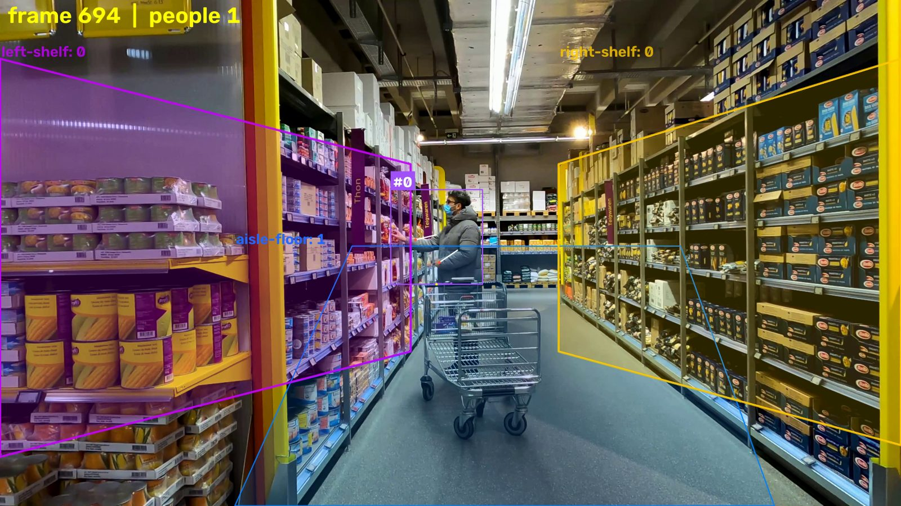
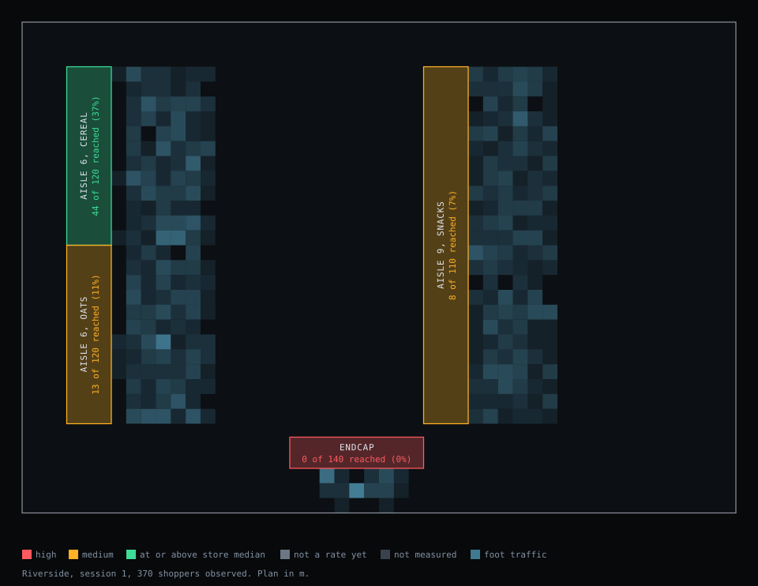

# OpenV

Shopper intelligence that runs on the cameras a store already has.

OpenV reads existing security camera feeds and turns what shoppers do into a
structured, anonymous event stream: where they walk, where they stop, how long
they stay, and which shelves they reach into. It joins those events to the
store's own map of what sits on each shelf, so a number about a place becomes a
number about a product and a brand. An agent then explains what is going wrong
at the shelf and drafts the fix, and an aggregate export carries the same
numbers to the retailer and to the brands on that shelf.

The cameras are the sensor. The store map is the retailer's. The agent is the product.



*The bundled grocery clip with zones drawn and pose on. Shelf zones are tested against wrists, the aisle against foot points. The hand is inside `left-shelf` here and the reach is recorded once it ends, 0.6 seconds later. Same renderer as `openv track --out`.*

## What it measures

| Signal | How it is measured | Where |
|---|---|---|
| Traffic | people detected and tracked per camera, counted per zone | `openv track` |
| Path and speed | foot points projected onto the store floor plan, sampled at 1Hz | `--floor` |
| Dwell and stops | one continuous stay per shopper per zone, debounced | `--zones` |
| Reaches | a wrist inside a shelf zone with the arm extended | `--pose` |
| Funnel | passed, stopped, reached per shelf, ranked against the store's own median | `openv analyze` |
| Products and brands | the zone numbers, joined to the retailer's store map | `openv export` |
| Whether a change worked | one zone across two sessions, as a verdict and not a delta | `openv measure` |
| One brand across stores | export files pooled, every store kept visible | `openv rollup` |

## What it will not collect

OpenV stops at behaviour. The items below are left out by construction, and
`tests/test_privacy_posture.py` fails if one of them appears in the code.

- **No faces and no biometric identifier.** No face embedding is computed, stored or sent.
- **No demographic guess and no emotion inference.** Contested science, and prohibited ground under the EU AI Act.
- **No identity across visits.** A track id lives for one session and dies when the shopper leaves frame. Nothing links Monday's shopper to Tuesday's, or one store's to another's.
- **No retained video.** Frames exist in the processing buffer and nowhere else.
- **No product recognition by camera.** A ceiling camera cannot read a label reliably. Products come from the store map.

This is the commercial argument as much as the legal one. The export is a file
a buyer's counsel can read end to end: aggregate counts per zone, and a list of
what the pipeline never produces. See [CLAUDE.md](CLAUDE.md) for the caselaw
and the precise claims.

## Status

| Phase | Scope | State |
|---|---|---|
| M0 | Detection and tracking | done |
| M1 | Zones, visits, dwell, event store | done |
| M2 | Pose and reach detection | done, specificity validated, sensitivity open |
| M3 | Analysis and agent | done, agent path unrun |
| M4 | Live camera, browser console | done in software, unrun on a real fixed camera |
| M5 | Floor coordinates, plan view | done bar multi-camera |
| M6 | Agent tools and chat | built and tested against a scripted client, unrun live |
| M7 | Re-measurement, digest, webhook | done |
| M8 | Store map, product and brand numbers, export | done on synthetic data, unrun with a retailer's planogram |
| M9 | Multi-store | rollup across export files done, shared database not started |

What is still open is not code: a real fixed camera in a store, a live run of
the agent with credentials, footage of a reach with the whole body in frame,
and a retailer's own planogram. [docs/roadmap.md](docs/roadmap.md) has the
detail and the order.

## Try it with no camera

Everything above the detector is deterministic code over an event store, so it
runs without a camera, a GPU or an API key. This writes two synthetic stores:

```bash
uv sync
uv run openv demo-store
```

Then read them the way a real session is read:

```bash
uv run openv analyze --db out/demo/store-014.db
uv run openv measure shelf-endcap --db out/demo/store-014.db
uv run openv export --db out/demo/store-014.db --session 1
uv run openv planview --db out/demo/store-014.db --session 1 --out out/demo/plan.svg
```

The demo numbers are invented and labelled `synthetic` in the store. They show
what the commands say about a store shaped like that one, and nothing else.

## Quickstart

```bash
uv sync
```

Grab the grocery store sample footage:

```bash
uv run openv fetch-sample grocery-store
```

Run on it:

```bash
uv run openv track data/grocery-store.mp4 --out out/tracked.mp4
```

Run on a webcam:

```bash
uv run openv track webcam:0 --show
```

## Live console

Camera in, overlay and running numbers in the browser. Draw zones by clicking on
the video. Everything it measures goes to the same event store the offline
pipeline writes, so a live session is analysable afterwards with the same
`openv analyze`.

```bash
uv run openv live --pose
```

The source can be a video file instead of a camera. File replay loops and is paced
to the source framerate, so the whole live path is demonstrable and testable with
no camera in front of it:

```bash
uv run openv live --source data/grocery-store.mp4 --zones data/grocery.zones.json --pose
```

Pacing matters: replaying a file as fast as it decodes would make every dwell
number meaningless against the clock the viewer is watching.

| Flag | What it does |
|---|---|
| `--source` | `webcam:N`, or a video file to replay |
| `--pose` | enable reach detection on shelf zones |
| `--floor` | floor.json, adds the plan view and records positions |
| `--map` | store map JSON, recorded with the session so reaches read as products |
| `--db PATH` | event store for the session (default `out/openv.db`) |
| `--no-db` | do not persist; numbers vanish on exit |
| `--no-loop` | stop at the end of a video file instead of rewinding |

Opens `http://127.0.0.1:8000`. The capture and inference loop runs on its own
thread and publishes the latest annotated frame plus a stats snapshot; HTTP
handlers only read those slots, so several open tabs cost nothing extra and a slow
inference pass never stalls the page.

Video is MJPEG because it needs no client library and no negotiation. Stats are
polled once a second, which a socket would not improve on.

Changing zones resets the counts on purpose: numbers gathered against different
boundaries are not comparable.

## Recording your own footage

Fixed-camera footage is what this is built for. The bundled samples cannot validate
dwell: one is 8 seconds long, the other has a moving camera.

```bash
uv run openv record --out data/my-store.mp4 --seconds 600
```

The camera must not move once recording starts.

Webcams routinely ignore the framerate you ask for. The recorder measures the rate
actually delivered during warmup and writes the file with that, because a file that
claims 30fps while the camera delivered 7 plays at 4x speed and divides every dwell
time by four. USB bandwidth is usually the limit: a camera that manages 30fps at
640x480 often drops to 7fps at 1280x960. Both are fine for dwell and path.

## Zones and events (M1)

Draw the areas you want numbers for. Click points, `n` to name and close a zone,
`s` to save.

```bash
uv run openv zones data/grocery-store.mp4 --out data/store.zones.json
```

Then track with zones enabled. Every shopper's stay in every zone becomes a visit
record in SQLite, and the funnel prints at the end.

```bash
uv run openv track data/grocery-store.mp4 --zones data/store.zones.json --db out/openv.db
```

Re-read the numbers any time:

```bash
uv run openv report --db out/openv.db
uv run openv report --db out/openv.db --all-sessions
```

### What a visit is

One continuous stay by one shopper in one zone. Enter time, exit time and dwell are
all derivable from it, so the visit is the durable record.

Two details make the dwell numbers trustworthy:

- **Debounce.** A shopper standing on a zone edge flickers in and out. A visit only
  opens after `--enter-seconds` continuously inside and only closes after
  `--exit-seconds` continuously outside, so one shopper at one shelf is one visit,
  not forty.
- **Backdating.** Timestamps are rolled back to when the streak actually started,
  otherwise every dwell reads short by the debounce window.

Shoppers who walk out of frame while inside a zone get their visit closed after
`--lost-seconds` rather than hanging open and vanishing from the numbers.

Zones may overlap on purpose. An end-cap sits inside an aisle, and a shopper at it
should count for both.

## Reaches (M2)

A visit says a shopper stood there. A **reach** says they engaged. That is the
difference between dwell and an actual funnel.

Zone `kind` picks which body point is tested:

| kind | tested against | produces |
|---|---|---|
| `shelf` | wrists | reaches |
| anything else | foot point | visits |

Draw a `shelf` zone over the shelf face, then run with pose on:

```bash
uv run openv track data/my-store.mp4 --zones data/my.zones.json --db out/openv.db --pose
```

Pose costs roughly 14ms per person per frame and is off by default.

## Analysis and recommendations (M3)

```bash
uv run openv analyze --db out/openv.db
```

```
shoppers observed   370  (upper bound, see note)
store median reach  5%

!! shelf-endcap: 74% of 140 shoppers walked past, only 1% reached. Store median is 5%
     passed 140 -> stopped 36 -> reached 2   (aisle: aisle-6-endcap, mean dwell 2.2s)

 ! shelf-snacks: 72% of shoppers stopped but only 5% reached. They looked and did not engage
     passed 110 -> stopped 79 -> reached 5   (aisle: aisle-9-snacks, mean dwell 4.4s)

   shelf-cereal: 30% reach rate across 120 shoppers, at or above the store median
```

Those are three different problems and they need three different fixes. A dead
zone with traffic is a placement problem; shoppers who stop and never reach are an
attention problem at the shelf face.

**Shelves are paired to aisles from the data, not from configuration.** A shelf's
reachers were standing somewhere while they reached, and the aisle they were most
often standing in is the one that shelf faces. A hand-maintained mapping would
drift out of sync with the store; this cannot.

**The benchmark is the store's own median**, not an industry figure. A retailer can
argue with an external number. They cannot argue with their own other aisles,
measured the same way on the same day.

Below 30 observed shoppers a rate is not reported as a rate. "0% reach" off three
shoppers is a lie dressed as data.

**A shelf nobody reaches is reported, not skipped.** The event store records the
zone set every session was measured against, so a shelf zone that was drawn,
watched with `--pose` on, and never reached is a dead fixture rather than a
missing row. It ranks high. Zero engagement from a confident number of shoppers
is the most actionable thing a merchandiser can be told, and it needs no
benchmark to be true. With pose off, zero reaches is a setting and is not
reported as anything.

Measured on `people-walking.mp4`, tiled, pose on: 95 shoppers crossed the shelf
zone, none reached, and `analyze` reports it as dead and ranks it high. Before
the zone set was recorded, the same run printed "no shelf zones with reach data
yet".

A dead shelf has no reachers to learn its aisle from, so it is paired to the
nearest floor zone in the drawing instead, and the funnel says so
(`paired_by: geometry`). The moment a reach is recorded, where people actually
stood takes over.

### The agent

```bash
uv run openv advise --db out/openv.db
```

Needs credentials (`ANTHROPIC_API_KEY`, or `ant auth login`). Two rules it runs
under:

- **It never computes.** Every number it cites was computed by `analyze` and handed
  to it. The prompt carries findings, never raw rows.
- **It never executes.** Output is stored with status `proposed`. No code path sets
  `approved`, because approval is a human decision and that is the liability gate.

OpenV measures zones, and the cameras cannot see what is on a shelf. With no
store map, recommendations cover placement, shelf height, facing count, and
signage, not "move SKU-204". With one, each finding carries the retailer's own
list of what is on that shelf, and the advice can name those items and no
others. The system prompt forbids inventing a SKU, brand or price in both cases,
and forbids giving a shared zone's numbers to one of the items in it.

If credentials are missing, `analyze` is unaffected: it needs no model at all.

### Telling someone

```bash
uv run openv digest --db out/openv.db --compare
```

A finding nobody reads is worth nothing. The hard part is not the sending, it is
deciding what deserves to be sent, and there are two ways to get it wrong:
listing every zone buries the line that mattered, and posting "nothing to report"
every morning teaches people to mute the channel before anything matters.

So a digest with nothing to say says nothing, and **exit code 2 means do not
send** while 0 means do. A scheduled job branches on that without parsing
anything. `--json` emits the same decision for a connector.

Only high and medium findings reach someone unprompted. A zone is re-measured
against the previous session if it is worrying now **or was worrying then**: a
shelf that was a problem, was changed, and is no longer a problem has by
definition dropped out of the current findings, and looking only at those would
announce every failure and no success.

To actually send it:

```bash
uv run openv digest --db out/openv.db --compare --dry-run
uv run openv digest --db out/openv.db --compare --webhook "$SLACK_WEBHOOK_URL"
```

Slack, Discord, Teams and Google Chat incoming webhooks all accept the default
`{"text": ...}` body, so there is no per-vendor adapter. `--format json` posts
the whole structure instead. `--dry-run` prints the exact body and sends nothing.

A digest that is not worth sending is not sent, and that is a success with
nothing done rather than an error, because scheduled jobs run on quiet days too.
A send that fails is reported and exits non-zero: numbers that look attended to
and are not being read are worse than numbers nobody scheduled.

**What leaves the machine:** zone names, shopper counts, findings and verdicts.
No images, no frames, no track identifiers, nothing about any individual. A test
asserts this rather than trusting the sentence.

### Did the change work?

```bash
uv run openv measure endcap --db out/openv.db
```

With no session ids it compares the two most recent runs that actually contain
that zone, and prints which pair it picked. `--before` and `--after` override it,
and `openv sessions` lists what has been recorded.

The question a retailer asks after acting on a recommendation, and the one that
makes this renewable rather than a one-off study. It needs no model.

It is also the easiest place in the product to produce confident nonsense. Two
rates always differ by something, and reporting that difference as a result
makes noise look like evidence in a document someone plans against. So the
answer is a verdict rather than a delta:

| verdict | meaning |
|---|---|
| `improved` / `worsened` | larger than chance would produce at this sample size |
| `indistinguishable` | a real answer, and usually the correct one early on |
| `not_enough_data` | no rate exists on one side, so there is nothing to compare |
| `not_comparable` | the zone polygon moved between the sessions, so the two numbers describe different boundaries |

Measured: 30 shoppers before and after, 5 reaches then 7. That is a 40% relative
improvement if you are careless. OpenV calls it `indistinguishable` at p = 0.52
and prints "This is not a result. Do not plan against it."

The test is a pooled two-proportion z-test at p < 0.05. When the normal
approximation behind it stops applying, which happens with plenty of traffic but
almost no reaches, it returns `not_enough_data` rather than a number that looks
like the others and is not comparable to them.

Each session records the polygons it was measured against, so `measure` can
tell that a zone was redrawn between two runs and refuses to compare across
it. The live console has always reset its counts on a zone change for the same
reason; this is that rule applied where it has consequences. It also means a
dead fixture compares against its fix: zero reaches on a watched shelf is a
measurement, not a missing row, and a `.db` reads without the zones file that
produced it.

### Asking questions

```bash
uv run openv ask "which shelf is losing the most shoppers" --db out/openv.db
```

`advise` hands the model a fixed set of findings. `ask` cannot work that way,
because the question decides which numbers matter, so the model gets **tools**
instead of a payload and `tools.py` is its only route to a number.

That distinction is what keeps the answers defensible:

- **Rates cross as verdicts, not ingredients.** A rate arrives as a value that is
  either a number or `null`, and when it is `null` the reason travels in the same
  object. The counts stay visible, but already labelled as not rate-able, so a
  model cannot turn "1 of 12 shoppers" into a confident 8% that `analyze` refused
  to state.
- **Comparisons are computed by the tool**, not left to the caller, so two
  withheld rates cannot be quietly subtracted into a confident difference.
- **Every call is kept.** The answer prints what it looked up, and `--show-calls`
  prints what each returned. A number whose provenance is hidden is a number
  people stop checking.
- **No tool can approve anything.** Approval is a human decision, and a test
  asserts no approving tool ever gets added.

### The false-reach problem

A shelf zone is a flat polygon in image space, so **it cannot tell a hand at the
shelf face from a hand merely between the camera and the shelf.** A shopper pushing
a trolley down the aisle has both hands inside the shelf polygon from the camera's
point of view, and counting that as engagement would fill the funnel with people
who never touched anything.

The fix is arm extension: wrist-to-shoulder distance measured in units of the
shopper's own shoulder width, so it holds regardless of how far away they are. A
resting hand sits near the body; a reach extends. `--min-arm-extension` tunes it,
default 2.5, and 0 disables the check.

That ratio has one failure mode worth knowing about. Apparent shoulder width is
the denominator, and it collapses when a shopper turns side-on to the camera,
because the two shoulders project onto each other. The ratio then runs away and
passes anything. Measured on real footage: one shopper's hand never left the
trolley handle, yet scored 1.3 facing the camera and 4.1 once they turned. So the
denominator is floored at 0.20 of the shopper's own standing height, which barely
moves with rotation. Bodies running off the edge of the frame are skipped
entirely, since a truncated box has the wrong height and half a torso.

Measured on `grocery-store.mp4`, which contains one genuine reach and three
trolley-push stretches: **7 reaches before, 1 after, and the survivor is the real
one.**

Specificity was then checked on `people-walking.mp4`, a high overhead concourse
where nobody reaches for anything, so every reach reported is a false positive by
construction. Across 29 shoppers who all crossed a shelf zone:

| `--min-arm-extension` | reaches reported |
|---|---|
| 0, geometry only | 43 |
| 1.6, the previous default | 4 |
| 2.5, the current default | **0** |

Pooling both clips, every non-reach measures at most 2.49 and the genuine reach
measures at least 2.59, so the default sits inside a real gap rather than flush
against the data.

`tests/test_reach_fixture.py` pins all of it against real MediaPipe keypoints
rather than hand-built poses. Reintroducing any one of the three fixes
misclassifies between 1 and 55 recorded samples.

Specificity is on firm ground: 15 distinct bodies across two camera geometries,
zero false positives.

**Sensitivity is not, and the likely error is missed reaches.** The one
validated reach is anatomically implausible. Its arm measures 0.52 to 0.57 of
box height where a real arm is about 0.44, and apparent shoulder width is 0.08
to 0.16 where anatomy says about 0.23. The probable cause is that the shopper's
lower body is hidden behind their trolley, so the box stops short of the floor,
standing height is underestimated, and the floored denominator inflates the
ratio.

That is the ordinary retail case, not an edge case. A shopper whose whole body
is visible while reaching should measure about 1.9, and would be missed at 2.5.
886 wrist measurements across two basketball players, fully visible and
extending their arms constantly, top out at 2.16.

So 2.5 is safe against false reaches and unproven against real ones. Closing
this needs footage of a reach with the whole body in frame.

### Settling it

Roughly two minutes of footage answers the question. **Stand fully in frame,
feet visible, no trolley or counter cutting off your legs**, which is the whole
point: the existing clip fails precisely because it does not.

```bash
uv run openv record --out data/reach-test.mp4 --seconds 120 --countdown 10
uv run openv zones data/reach-test.mp4 --out data/reach-test.zones.json   # 's' for shelf
uv run openv fixture data/reach-test.mp4 \
  --zones data/reach-test.zones.json \
  --out tests/fixtures/reach_visible_poses.json \
  --reach 200-260 --reach 500-560 \
  --not-reach 300-400 \
  --note "whole body visible, deliberate reach into a shelf"
```

`openv fixture` captures the keypoints and runs the anatomy check on the spot,
so you find out immediately whether the clip is usable rather than after
analysis. If it reports the arm at around 0.44 of box height, the clip can
settle the threshold. If it reports 0.52 or more, the body is still cut off and
the footage tells us nothing new.

Then ask what the pooled fixtures say the threshold should be:

```bash
uv run openv reach-threshold tests/fixtures/reach_poses.json tests/fixtures/reach_visible_poses.json
```

It reads the same `extension_ratio` the detector uses, so the number under
discussion is the number that ships, and it reports the separation, the margin,
the suggested threshold, and how many reaches the current default would miss.

The prediction to falsify: a fully-visible reach should measure near **1.9**
shoulder widths, not the 2.6 the current fixture shows. If it does, 2.5 is too
high and reaches are being missed.

### Useful flags

| Flag | What it does |
|---|---|
| `--out PATH` | write an annotated mp4 |
| `--show` | live preview window, `q` to quit |
| `--max-frames N` | stop after N frames, good for a quick check |
| `--device cuda\|cpu` | defaults to cuda when available |
| `--conf FLOAT` | detection confidence threshold, default 0.4 |
| `--resolution PX` | detector input size, default 896, must be divisible by 32 |
| `--slice PX` | tiled inference, for wide or high camera mounts |
| `--tracker NAME` | `bytetrack` (default), `botsort`, `ocsort`, `sort` |
| `--min-arm-extension` | reach threshold in shoulder widths, default 2.5, 0 disables |
| `--map PATH` | store map JSON, recorded with the session |
| `--no-trace` | turn off the path trails |
| `--no-half` | disable fp16 |

## Measured on an RTX 3070 (8GB)

Two things dominate whether a shopper gets seen at all, and both are tunable.

**Detector input resolution.** A mid-aisle shopper in a 4K frame, whole-frame inference:

| Resolution | Result | Latency |
|---|---|---|
| 576 (RF-DETR default) | 0.42 confidence, plus a false positive | 79ms |
| 896 (our default) | 0.80 confidence, clean | 107ms |
| 1280 | 0.83 confidence, clean | 203ms |

**Tiling.** An overhead fixed camera over a crowd, shoppers ~20px tall after downscaling:

| Mode | People found | Median confidence | Latency |
|---|---|---|---|
| Whole frame | 4 | low | 0.15s |
| `--slice 896` | 126 | 0.86 | 1.32s |
| `--slice 640` | 138 | 0.88 | 2.35s |

Tiling is the difference between missing a crowd entirely and resolving all of it. It costs
roughly 8x the compute at `--slice 896`, which the table above shows directly (0.15s to
1.32s), so it is opt-in per camera. Two numbers get confused here and they are not the
same: tiling with pose runs at roughly **15x realtime** on 1080p, but that is wall-clock
against the source frame rate, not a ratio against whole-frame inference. Size hardware
from the 8x.

Note that behavior analytics does not need 30fps: dwell, path and conversion are all fine
at 2 to 5fps, which is what makes the tiled mode practical on real hardware. Tiling is also
not free in accuracy terms, see `docs/loop-findings.md`: it inflates unique-shopper counts
by roughly 18-29%, worst for far zones.

fp16 was verified to match fp32 confidences to within 0.001, so it is on by default on CUDA.

## Floor mapping

A camera sees the store obliquely, so ten pixels means centimetres in the
foreground and metres down the aisle. Every spatial question (how far, how fast,
how much floor a display actually commands, where on the store plan) needs
pixels turned into floor positions first.

The floor is a plane, so one 3x3 homography does it. Four correspondences
between points in the image and the same points on the store's floor plan solve
for it, and stores already have floor plans, so nothing is reconstructed from
pixels.

Click a feature on the floor, type where it sits on the store plan, repeat:

```bash
uv run openv floorplan data/my-store.mp4 --out data/my-store.floor.json
```

| Key | What it does |
|---|---|
| click | add a point, then type its plan coordinates |
| `w` | rectified preview, the calibration check |
| `u` | undo the last point |
| `s` | save and quit |
| `q` | quit without saving |

Click floor features only: tile corners, floor markings, door thresholds. A
shelf edge or the top of a display is not on the ground plane, and a homography
maps one plane to another, so one point off the floor skews the whole mapping.

Then record where shoppers actually stood:

```bash
uv run openv track data/my-store.mp4 --zones data/my.zones.json \
  --floor data/my-store.floor.json --db out/openv.db
```

Positions are sampled at 1Hz per shopper rather than written every frame.
Behaviour analytics does not need 30Hz, and per-frame rows would be thirty times
the storage for no extra insight while turning an event store into a movement
database. `--position-interval` tunes it.

Read the paths back with no video involved, which is what any later question has
to rely on:

```python
from openv.store import EventStore

with EventStore("out/openv.db") as store:
    paths = store.paths(store.latest_session_id())   # {track_id: [(t, x, y)]}
```

Because positions carry time, speed falls out of them. Measured on
`people-walking.mp4`: median 1.17 tiles per second, which at a roughly 1.2m
floor slab is about 1.4 m/s. Nothing was fitted to produce that, so ordinary
walking pace arriving on its own is a reasonable check that the scale is honest.

Three things this refuses to do, all of them deliberate:

- **Only foot points project.** A box centre floats up the body, and asking
  where a floating point lands on the ground has no answer. This is the same
  reason zone membership already uses `Box.foot_point`.
- **Points above the horizon return `None`.** The ground plane has no finite
  image there. A number would read as a shopper standing through a wall.
- **Four correspondences report no reprojection error at all.** A homography has
  eight degrees of freedom and four point pairs supply exactly eight equations,
  so the fit is exact whatever the points are, including four clicked on a shelf
  edge. Reporting `0.000` there would be a confident number standing in for no
  evidence. The fifth point is what buys a residual.

Since four points cannot check themselves, `w` in the calibrator warps the frame
onto the floor plane so it can be judged by eye: if the floor's own tiles and
joints come out square and parallel, the points were on the ground plane. If
they fan out, they were not. The HUD says `UNVERIFIABLE` at four points rather
than showing a reassuring zero, and saving with four prints the same warning.

Verified on `people-walking.mp4`: converging tile lines rectify to parallel, and
34 tracked people project to plan-view paths that run straight, which is what
walking in a straight line should look like once the perspective is removed. In
the rectified frame the people themselves smear outward, because a person has
height and only the floor is being mapped. Their feet land correctly and nothing
above the ankle does, which is the foot-point rule made visible.

This is the layer a multi-camera bird's-eye view sits on: several cameras
sharing one floor coordinate space.

## Store map and product numbers (M8)

OpenV measures zones. The retailer already knows what is on every shelf: that is
what a planogram is. A store map is that knowledge in one small file, and
joining it to the zone numbers gives product and brand numbers with no product
recognition and no new hardware.

```json
{
  "store": {"id": "store-014", "name": "Riverside", "units": "m",
            "outline": [[0, 0], [16, 0], [16, 11], [0, 11]]},
  "fixtures": [
    {"zone": "shelf-cereal", "label": "Aisle 6, cereal",
     "plan": [[1, 6], [2, 6], [2, 10], [1, 10]],
     "products": [
       {"sku": "100234", "product": "Oat cereal 500g", "brand": "Northfield",
        "category": "cereal", "facings": 6, "level": "eye"}
     ]}
  ]
}
```

`zone` names a shelf zone from the zones file. `plan` and `outline` are optional
and use the same floor units a `floor.json` calibrates to. This is store data,
not shopper data, and the privacy posture is untouched by it.

Check a map against the zones before recording with it. A fixture that points
at a zone which does not exist would otherwise show up an hour later as a
product nobody touched:

```bash
uv run openv storemap data/grocery.map.json --zones data/grocery.zones.json
```

Then record with it:

```bash
uv run openv track data/grocery-store.mp4 --zones data/grocery.zones.json \
  --map data/grocery.map.json --db out/openv.db --pose
```

**The map is recorded with the session**, the same way the zones are. Planograms
are reset every few weeks, so "what was on that shelf" is a fact about a
session. Last month's reaches are read against last month's map, and a `.db`
needs no file beside it to be read.

A session captured without a map can have one recorded afterwards, checked
against the zones that session itself recorded:

```bash
uv run openv storemap data/grocery.map.json --attach --db out/openv.db
```

It refuses to overwrite a map without `--replace`.

### The one rule

**A number belongs to a brand only where the brand has the zone to itself.**

A reach lands in a zone. If the zone holds one brand, every reach there was a
reach for that brand. If it holds three, each reach was for one of the three and
the data does not say which. Splitting the zone's reaches by share of facings
would give every brand a tidy number, and every one of those numbers would be an
assumption about shoppers presented as a measurement of them. It is also the
exact assumption a brand pays to have tested. So a shared zone is reported as
shared, and the brand gets no number there.

On the synthetic demo store:

<!-- demo-export -->
```
Riverside  (store store-014, session 1, 2026-11-10T20:02:24+00:00)
shoppers observed 370, store median reach 9%

   brand                  facings  passed  stopped  reached       reach  measured on
------------------------------------------------------------------------------------
!! Tallow Lane                 12     140       27        0          0%  shelf-endcap
 ! Harrow & Pike               12     110       86        8          7%  shelf-snacks
   Northfield                  13     120       74       44         37%  shelf-cereal
 - Oatwright                    3                             no number  shared: shelf-oats

   category               facings  passed  stopped  reached       reach  measured on
------------------------------------------------------------------------------------
!! snacks                      24     250      113        8          3%  shelf-snacks, shelf-endcap
   cereal                      16     120       74       48         40%  shelf-cereal, shelf-oats

   shelf zone              passed  reached       reach  on it
-------------------------------------------------------------
!! shelf-endcap               140        0          0%  Tallow Lane
 ! shelf-oats                 120       13         11%  Northfield, Oatwright
 ! shelf-snacks               110        8          7%  Harrow & Pike
   shelf-cereal               120       44         37%  Northfield
```

Three things in that table are the design:

- **Oatwright has no number.** It shares `shelf-oats` with Northfield. Thirteen
  shoppers reached into that zone and nothing says whose product they wanted. A
  zone drawn over its section alone would measure it.
- **Northfield's 44 does not include any of those 13**, although Northfield is
  in `shelf-oats` too. Its facings there are counted as a fact about the shelf.
  Its reaches there are not counted at all.
- **Cereal is measured over both zones**, with each shopper counted once.
  Shared between brands is not shared for the category.

That makes zone granularity the granularity of product insight. One polygon over
a whole bay answers bay questions. One polygon per section answers section
questions.

The same rule holds one level down: an item is measured only when its zone holds
nothing else. And a mapped fixture that was not watched with pose on is reported
as not measured, never as untouched.

### The plan

```bash
uv run openv planview --db out/openv.db --out out/plan.svg
```



*The synthetic demo store. Fixtures are coloured by their finding, and the blue
layer is foot traffic from recorded floor positions. The drawing is an SVG built
from aggregates: no camera pixels, and no track behind any cell.*

Fixtures need a `plan` polygon to be drawn, and the traffic layer needs a
session recorded with `--floor`.

## The export

```bash
uv run openv export --db out/openv.db --out out/store-014.json
uv run openv export --db out/openv.db --brand "Northfield" --out out/northfield.json
```

This is the one file that leaves the store for somebody else, so "anonymised"
has to be a property of the bytes. It is built from aggregates only, there is
no code path from a track id, a position or a frame to it, and a test walks
every key of the output to hold it to that.

**What is in it:** zones, the retailer's own product data for those zones, and
counts of shoppers who passed, stopped and reached, for one session of one
store. Every rate is the guarded rate the rest of the system uses, so a row
with fewer than 30 shoppers carries its counts and a stated refusal, never a
percentage.

**What every file states about itself:**

```json
"privacy": {
  "unit": "aggregate counts per zone, for one session of one store",
  "min_shoppers_for_a_rate": 30,
  "excludes": [
    "no video, frames or stills",
    "no track identifiers, and no row per shopper",
    "no individual positions or paths",
    "no faces and no biometric identifier of any kind",
    "no demographic inference and no emotion inference",
    "no link between a shopper in one session and the same shopper in another"
  ]
}
```

`--brand` narrows the file to one brand: the zones it is in, its own items, and
its category as the benchmark. Other brands are counted and never named. That
narrowing is commercial confidentiality between a retailer and its suppliers.
Shopper privacy is identical in both files. The retailer decides what a brand is
shown, and this is the narrow default.

The agent reads products through the same layer. `openv ask` has two more
tools, `list_products` and `get_brand`, and they are its only source of a
product or brand name. A brand with no number comes back with the reason and no
counts to divide.

## Across stores (M9)

A retailer reads one store. A brand buys coverage: the same question asked of
every store its product is in.

```bash
uv run openv rollup out/store-014.json out/store-022.json
```

```
2 sessions from 2 stores: store-014, store-022

Tallow Lane: passed 280 -> stopped 57 -> reached 23, reach 8%  (measured at 2 of 2)
    store-014 #1            passed   140  reached    0  reach         0%  dead
    store-022 #1            passed   140  reached   23  reach        16%  healthy
```

It reads export files and nothing else, so it runs wherever those files are and
needs no access to any store's database, footage or cameras. Three refusals:

- **The same session twice is an error.** Two copies of one file would double
  that store and look like traffic.
- **A store with no number adds nothing to the pool.** It is listed as
  contributing nothing, not dropped and not estimated.
- **Every store stays beside the total.** The pooled 8% above is two stores
  that disagree completely, and the two rows say so.

Nothing links a shopper between two files. Someone who shops at two stores, or
at one store on two days, is counted in each. That is the design.

`--by category` groups on category instead.

## Stack

| Layer | Library | License |
|---|---|---|
| Detection | RF-DETR (Nano/Small/Medium/Large only) | Apache 2.0 |
| Tracking | roboflow/trackers (ByteTrack, BoT-SORT, OC-SORT, SORT) | Apache 2.0 |
| Tiling, annotation | supervision | MIT |
| Video IO | OpenCV | Apache 2.0 |
| Pose | MediaPipe | Apache 2.0 |
| Live console | FastAPI, uvicorn | MIT, BSD-3-Clause |
| Agent | Anthropic SDK | MIT |

RF-DETR's XLarge and 2XLarge checkpoints ship under Roboflow's PML 1.0, not Apache 2.0,
and are deliberately not exposed.

No AGPL dependencies. See [CLAUDE.md](CLAUDE.md) for the full constraint list, including
the privacy posture that keeps this out of BIPA and EU AI Act exposure.
